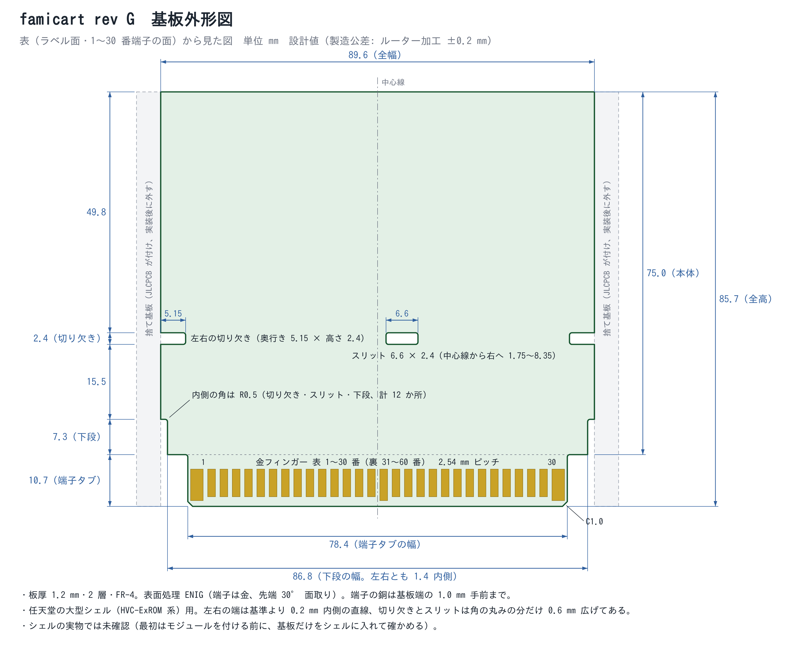
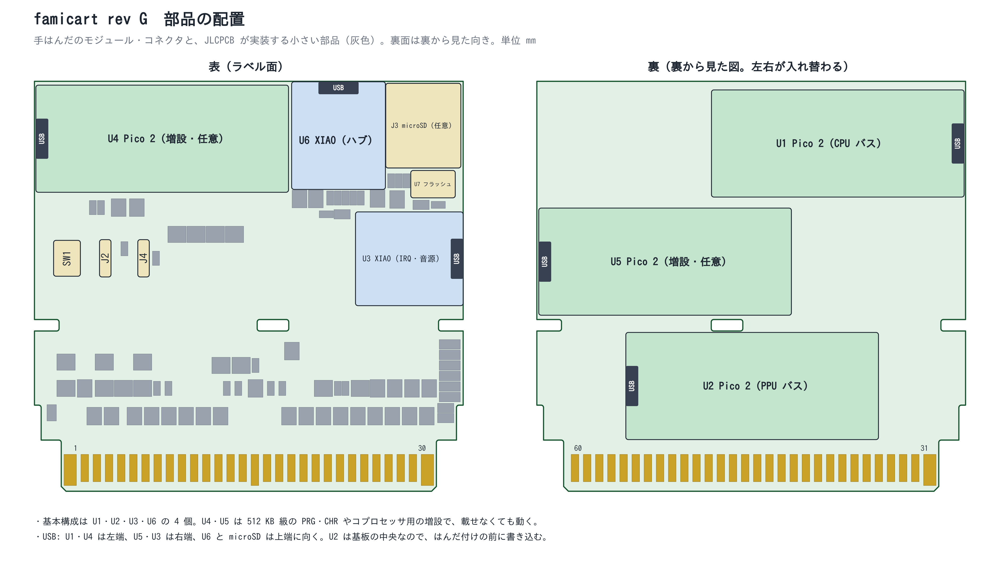

# 12 rev G（Pico 2 ×2 ＋ XIAO RP2350 ×2 を基本に、増設 Pico 2 ×2・フラッシュ・microSD）

2026-11-10 作成。ネットリストと配置は `tools/pcb/design_revg.py`。ファミコン本体の仕様と端子の機能は [11](11_famicom_reference.md)。部品選定のルールは [06](06_rev_e_plan.md) と同じ（JLCPCB Basic 部品のみ、手はんだは秋月の在庫品）。

レビューは 8 分野（CPU バス、PPU バス、ファミコン仕様、構成案、電気、音声・LINK・IRQ、マッパー網羅、SFC チップ）で、分野ごとに別の検証役が再確認する。この文書で「確定」と書いた項目は検証まで済んだもの、「検証中」はまだのもの。

## 目標

1. 正規ライセンスのファミコンソフトがすべて起動する。全マッパー（＋自作向けのマッパー 30）と拡張チップ・拡張音源を内蔵する。
2. スーパーファミコンの拡張チップの機能をすべて内蔵する。
3. 拡張チップは単体でも、組み合わせても使える。
4. ポリゴンを使うゲームが動く。最終的には、Model 1 級の 3D 格闘ゲーム風のソフトが BGM・効果音つきで動くところまで。

## 構成

| 部品 | 種類 | 面 | 役割 | 必須 |
|---|---|---|---|---|
| U1 | Pico 2 | 裏・上 | CPU バス。マッパー、PRG、カートリッジ RAM、LINK の親 | ○ |
| U2 | Pico 2 | 裏・下 | PPU バス。CHR、カートリッジ側ネームテーブル、PPU の書き込みの取り込み、画面用フレームバッファ | ○ |
| U3 | XIAO RP2350 | 表・中段右 | IRQ、ファミコンの拡張音源 6 種、CIRAM /CE と A10 の生成 | ○ |
| U6 | XIAO RP2350 | 表・上段 | ハブ。SFC チップの機能、フラッシュ／カード、PCM 音声、他モジュールへのファーム配布、PC との USB | ○ |
| U4 | Pico 2 | 表・上段左 | CPU バスの増設。PRG の後半を受け持つ。CPU バスに直接答えるコプロセッサの窓にも使える | 任意 |
| U5 | Pico 2 | 裏・中段 | PPU バスの増設。CHR の後半を受け持つ。PPU に直接答える描画にも使える | 任意 |
| U7 | W25Q128JVSIQ | 表 | 16 MB の SPI フラッシュ（JLCPCB Basic、LCSC C97521） | ○（JLCPCB 実装） |
| J3 | microSD ソケット | 表・上段右 | データの供給とファーム更新の予備手段（秋月 102395、手はんだ） | 任意 |

- 基本の 4 個（U1・U2・U3・U6）で動く。U4・U5 は載せなくてよい。
- **U4・U5 が要る理由（確定）**: バスに返すバイトは、そのサイクルのうちに出せるマイコンの RAM に置く必要がある。フラッシュから読むと、キャッシュに無いとき 1 回 350〜450 ns 掛かり、使える時間（145〜229 ns）に収まらない。RP2350 の RAM は 520 KB なので、Pico 2 が 1 枚では 512 KB の PRG・CHR が載らない。該当するライセンス品はファミコンで 24 本（PRG 512 KB が 23 本、CHR 512 KB が 1 本。[集計](#容量の集計)）。全ソフトを起動するには U4（23 本分）と U5（1 本分）を載せる。

## シェル（確定）

- **通常シェルには入らない。** `tools/pcb/shell_fit.py` の全探索で、通常シェルに入る Pico 2 は裏の下段に 1 枚だけ。CPU バス・PPU バスはそれぞれ GPIO が 26 本要り、XIAO（縁に 11 本、裏に 8 本）では代わりにならない。構成案の調査では、秋月の在庫品に、もっと小さくて 24 本以上を縁に出した RP2350 モジュールは見つからなかった（2026-11-10。検証中）。
- **大型シェル（任天堂 HVC-ExROM 系、互換の「でかカセットケース」）用**にする。本体 89.6 × 75 mm ＋ 端子タブ（左右の端は基準の 90 mm より 0.2 mm ずつ内側。理由は次の節）。
- U6 の USB-C は基板の上端、U3 の USB-C は右端、Pico 2 の USB は左右の端に向ける（基板の内側を向いた USB はケーブルが挿さらないため）。U2 だけは基板の中央なので、はんだ付けの前に書き込む。

外形図（寸法入り）と部品の配置図。どちらも `tools/pcb/draw_outline.py` が基板データから描いたもの:

## JLCPCB で作るための条件（2026-11-10、JLCPCB の公式ページで確認）

**前提**: 基板の製造と小さい部品の実装は JLCPCB に出す。以下は JLCPCB の現行の仕様・料金ページから取った条件と、それを rev G にどう反映したか。注文の手順は `hardware/revg/jlcpcb/README.md`（`tools/pcb/gen_jlc.py` が作る）。

### 要点

- **用語: 金フィンガー（gold finger）**は、基板の端に並べた金めっきの接点のこと。基板そのものをプラグにして本体のコネクタ（カードエッジコネクタ）に挿すためのもので、カセットの下端の 60 本（表 30 本・裏 30 本）がそれに当たる。金にするのは、錆びず接触抵抗が低いから。めっきには、抜き差し用の厚い硬質金（電解めっき、0.5〜1.5 µm 級）と、薄い ENIG（無電解ニッケルの上に置換金。JLCPCB で注文できる金の厚さは 1 U"〔約 0.025 µm〕か 2 U"〔約 0.05 µm〕の 2 つで、この基板は 2 U" を指定する）がある。**JLCPCB は硬質金を扱わず、ENIG を選んだときだけ端子が金になる**（HASL を選ぶと端子ははんだ〔錫〕）。ENIG の金は薄いので、このカセットは挿したまま使い、ゲームの入れ替えは USB か microSD で行う前提にしている。
- **金フィンガー付きの基板は Economic PCBA では受け付けられない。** JLCPCB の実装仕様表で、Gold fingers は Economic が "Not Support"、Standard が "Support"。rev E〜F2 の注文メモに書いていた「Economic」は誤りで、**Standard PCBA** になる（各 README を訂正した）。
- Standard PCBA は **捨て基板（Edge Rails）とフィデューシャルが必須**で、基板 1 枚が 70 × 70 mm 以上。捨て基板は幅 5 mm 以上。捨て基板は付いたまま届く。
- **JLCPCB に捨て基板を任せると、既定では「長いほうの 2 辺」に付く**（注文フォームの注意書き。この基板では上の辺と端子の辺）。端子の辺に付くと面取りができないので、**左右に捨て基板を描き込んだデータ（A 案、`gerbers_rails.zip`）を主にし**、基板だけのデータ（B 案、`gerbers.zip`。Remark で左右を頼む）も残した。捨て基板は基板から 2 mm 離し、片側 3 か所のミシン目のタブでつなぐ（V カットは使わない）。寸法は JLCPCB が「自社で実装するミシン目パネル」に示している数値に合わせた（下の表）。JLCPCB の定義ではこのデータは「自分で面付けしたデータ」なので、注文は Delivery Format を "Panel by Customer"（1 × 1）にして出す。捨て基板の付いた基板の端子を面取りしてもらえるか、この出し方でよいかは、どのページにも書かれていないので、**支払いの前に**サポートに確認する（質問文と図は注文メモ）。
- **部品の種類が 1 つ増えるごとに $1.53**（Standard はすべての部品にフィーダー費が掛かり、Basic と Extended で同額）。部品の種類を減らす方針は、費用にそのまま効く。Basic だけにしているのは、在庫が安定していて入手しやすいから（料金の差は Standard では無い）。
- 基板の製造条件（配線 0.15 mm、ビア、外形、シルク）は、すべて JLCPCB の標準の範囲に収めた。追加料金になるビア（穴 0.3 mm 未満かつ径 0.4 mm 以下）は使わない。
- JLCPCB は 2026 年 5 月に注文番号の印字（Mark on PCB の Order Number）をやめた。位置指定用の `JLCJLCJLCJLC` の文字は、置くとそのまま印刷されるので、基板から削除した。

### 料金（実装。JLCPCB の料金表、2026-10-22 更新）

| 項目 | Economic PCBA | Standard PCBA（片面） |
|---|---|---|
| セットアップ | $8.18 | $25.56（両面は $51.12） |
| ステンシル | $1.53 | $8.21（両面は $16.42） |
| はんだ付け | $0.0016／接点 | $0.0016／接点 |
| フィーダー | Extended 部品だけ 1 種類 $3.07 | **Basic も含め 1 種類 $1.53** |
| 1 枚あたりの最低額（はんだ付け） | なし | $0.48 |
| 梱包 | 無料 | $0.50 ＋ 面積分 |
| 治具（Fixture） | なし | 1 個 $8.21（29 枚以下は 2 個。どの注文に掛かるかは料金表に書かれていない） |
| 金フィンガー付きの基板 | **不可** | 可 |

rev G（10 種類、81 点、365 接点）を実装すると、実装費は 2 枚で約 $51、5 枚で約 $53 ＋ 部品代（計算は注文メモ）。Economic で頼めた場合との差は約 $40。

### 設計への反映

| 項目 | JLCPCB の条件 | rev G の設計 |
|---|---|---|
| 実装の種類 | 金フィンガーは Standard PCBA のみ。基板は 70 × 70 mm 以上 | Standard PCBA、表面のみ。基板は 89.6 × 85.7 mm |
| 捨て基板 | 幅 5 mm 以上、Standard では必須。JLCPCB が付ける場合は長い辺に付く。自分で付ける場合（製造仕様の "Mouse bites Panel" の行）: ミシン目のタブは幅 5 mm 以上、穴は 0.5〜0.8 mm、穴と穴の間は 0.2〜0.3 mm。自社で実装するなら、捨て基板 5 mm、ツーリング穴 2 mm、フィデューシャルは 1 mm で中心がパネルの端から 3.85 mm（捨て基板の説明の図では、パッドの縁から端まで 3.35 mm 以上。同じ位置を別の測り方で言っている）、レジスト開口は銅の 2 倍、3〜4 個 | **A 案**: 左右に幅 5.0 mm・長さ 83.0 mm の捨て基板を 2.0 mm 離して描き、片側 3 か所のタブ（幅 5.2 mm、Ø0.6 mm の穴 7 個、穴の間 0.3 mm）でつなぐ。穴は基板の端の線に外側から接する位置に置き、基板の中には入れない（基板側に銅箔の禁止帯を足すと、端とモジュールのパッドの間の配線の通り道が塞がって自動配線が終わらなくなったため）。折り取ったあとに残る 0.3 mm 以下の突起は、やすりで落とす。捨て基板は端子の辺の線より 2.7 mm 手前で終わる（面取りの刃が通る所を空ける）。フィデューシャル 3 個（中心がパネルの端から 3.85 mm）とツーリング穴 4 個（Ø2.0 mm）を捨て基板に置く。全体 103.6 × 85.7 mm（`make_rails.py`。寸法は `design_revg.py` の `RAILS`）。最初の版はタブ 4.2 mm・穴の間 0.4 mm・フィデューシャル 3.5 mm・ツーリング穴なしで、この行の条件を満たしていなかった（独立検証の指摘で修正）。**B 案**: 基板だけのデータで、左右に付けるよう Remark で頼む。そのために左右の端をそれぞれ 1 本の直線にしてある（基準の外形にあった 0.2 mm の段を無くし、左右とも 0.2 mm 内側に寄せた） |
| 外形の公差 | ルーター加工 ±0.2 mm、V カット ±0.4 mm | 上の 0.2 mm の逃げ。受け取り後に左右の端面をやすりで整える |
| 銅箔と基板端 | ルーター加工の端から 0.2 mm 以上、V カットの端から 0.4 mm 以上 | 0.3 mm 以上。左右の端は配線・パッドとも 0.4 mm 以上（`check_place.py` と配線禁止帯で保証） |
| スリット・内側の角 | 非めっきスリットは幅 1.0 mm 以上。角に丸みの無い角穴・スリットは作れない | スリットと切り欠きは幅 2.4 mm。内側の角は R0.5 mm で作図し、切り欠きの奥行き・スリットの長さ・下段の段差を 0.6 mm 広げて、基準の開口が丸みで狭くならないようにした |
| 配線幅／間隔 | 0.10／0.10 mm 以上（2 層・1 oz） | 0.15／0.15 mm |
| ビア | 穴 0.3 mm 以上が標準（追加料金は、穴 0.3 mm 未満かつ径 0.4 mm 以下のとき）。径は穴 ＋ 0.1 mm 以上（推奨 ＋ 0.15 mm）。穴どうし 0.2 mm 以上、穴と配線 0.2 mm 以上 | 径 0.5 mm・穴 0.3 mm（rev F2 までは穴 0.25 mm）。DRC は穴どうし 0.25 mm、穴と配線 0.2 mm |
| 金フィンガー | 金は ENIG。面取りは 30° か 45°（±5°）。面取りする範囲に銅を置かない。JLCPCB の図では、銅は基板の端から 1.15 mm（板厚 1.6 mm 以下、30°）手前で止める（1.6 mm・30° の別の図では約 1.13 mm）。足りない場合は JLCPCB が銅を短くする。基板は 50 × 50 mm 以上 | ENIG、30°。端子の銅は基板の端の 1.2 mm 以上手前で終わる（電源・GND の長い 4 本は、フットプリントでは 1.0 mm だったので 0.2 mm 短くした。そのほかは 2.0 mm） |
| 面取りと面付け | 「V カットで面付けした基板は、端子が面付けの内側に来るので面取りできない」 | 捨て基板を左右だけに付けてもらう（端子の辺は面付けの外周に残る）。面取りと捨て基板を同時に頼めるかは明記が無いので、断られたら面取り無しで作り、手で面取りする |
| 端子部のレジスト | 金フィンガーの範囲はレジストを全面開口にする（残すと抜き差しで剥がれる） | タブの付け根から 4.0 mm より先（配線・ビアを置かない範囲）を、表裏とも 1 つの開口にした。開口は J1 に持たせ、J1 に「レジストのブリッジを許す」属性を付けて DRC を通す |
| 端子の近くの穴 | めっき穴・SMD パッドは金フィンガーから 1.0 mm 以上（同社の記事の指針）。端子の近くにシルクを置かない | 端子の上端から 1.0 mm の範囲をビア禁止にした（配線は通す）。試し配線では、この禁止が無いとビアが端子の 0.15 mm 横に置かれた |
| シルク | 線幅 0.15 mm 以上、文字の高さ 1.0 mm 以上 | 生成時に全フットプリントのシルクをこの最小値に揃える（KiCad 標準ライブラリの線は 0.12 mm） |
| レジスト | 開口と開口の間 0.10 mm 以上（黒・白は 0.13 mm）。開口と隣の配線は 0.09 mm 以上 | 開口はパッドと同じ大きさ（端子のパッドも同じ）。開口の間は 0.25 mm 以上（最小は microSD ソケット J3 の 8・9 番パッドの間） |
| はんだペースト | ステンシルの開口は実装する部品のパッドだけに作られる | 手はんだ部品（モジュール、microSD ソケット、配線パッド）のパッドにはペーストを置かない |
| ガーバー | 製造に使う層とドリル | ZIP には銅箔・レジスト・シルク・ペースト・外形・ドリルだけを入れる（図面用の Fab 層は入れない） |
| 部品 | Basic Parts は在庫と区分が変わりうる | 全部品が Basic。`gen_jlc.py` が部品 API で区分と在庫（2 万個以上）を毎回確認する |

### 基板データの作り方

`tools/pcb/` で、次の順に実行する（`FC_DESIGN=design_revg FC_HW_DIR=../../hardware/revg` を付ける。配線幅・間隔・ビアは設計ファイルの値が使われる）。

| 手順 | コマンド | 内容 |
|---|---|---|
| 1 | `gen_sch.py` | 回路図とプロジェクトファイル |
| 2 | `route_pcb.py` | 基板の生成（`gen_pcb.py`。+5V の幹線と GND の帯はここで先に引く）、自動配線（Freerouting）、ベタ、DRC、ガーバー。この版の配置で 6〜7 分。結線が 1〜2 本残ることがある（手順 4） |
| 3 | `check_place.py` | シェルのリブ・ポスト、基板端、部品どうしの重なりの検査 |
| 4 | `close_open.py <基板ファイル>` | 自動配線が残した数本の結線を 1 本ずつ閉じる。中で `finish_route.py`（格子の迷路配線。邪魔な配線を剥がして通す）を呼び、剥がした分を引き直せて未接続が減ったときだけ結果を残す（`finish_route.py` だけを回すと、混んだ基板では未接続が増えていくことがある）。部品を動かしていない変更なら、配線をやり直さずに `copy_routing.py <配線済みの旧基板> <新しい基板>` で移す |
| 5 | `anchor_tracks.py <基板ファイル>`、`widen_tracks.py <基板ファイル>` | パッドの縁に浅く掛かって終わっている配線を、パッドの中心まで延ばす。続いて、電源と GND の配線（`NET_WIDTH` のネットと、コマンドで指定したネット）を、DRC が通る範囲で太くする。どちらも、配線の位置と接続は変えない |
| 6 | `stitch_gnd.py <基板ファイル>` | 表裏の GND ベタをつなぐビアを、両面にベタがあって空いている所に格子状に足す。そのあと `route_pcb.py export` で DRC とガーバーを作り直す |
| 7 | `gen_bom.py`、`gen_jlc.py` | 部品表、JLCPCB 用の BOM・CPL・ガーバー ZIP・注文メモ。部品が Basic で在庫があるかを JLCPCB の部品 API で確かめる。注文メモの数値（捨て基板の寸法、部品の向き、レジストの最小幅、はんだブリッジを見る所）は設計ファイルと基板から埋める |
| 8 | `make_rails.py` | 配線済みの基板に左右の捨て基板（ミシン目のタブ、フィデューシャル、ツーリング穴）を足した基板 `famicart_rails.kicad_pcb` と、そのガーバー（`gerbers_rails.zip`）を作る。基板の中身と座標は変わらないので、BOM と CPL は共通。DRC にエラーがあれば ZIP を作らない |
| 9 | `check_jlc.py` | 出来上がった基板と注文ファイルを、上の表の JLCPCB の条件と照合する（配線幅、ビアの穴径、穴の間隔、左右端の銅箔、内角の丸み、シルクの最小寸法、ペースト、実装面、端子の銅の後退、端子部のレジスト開口、端子とビア・シルクの距離）。2 つの ZIP は中身を「基板ファイルを今プロットしたもの」と 1 ファイルずつ比べる。捨て基板付きの基板は、中身（配線・ビア・部品・パッド・ベタ・外形）が基板だけのものと同じであることを確かめ、捨て基板の幅、タブの幅、ミシン目の穴径と間隔、フィデューシャルとツーリング穴の位置を基板から測る。DRC は 2 枚ともその場で実行する。未配線の基板、未接続のある基板、DRC エラーのある基板は不合格にする |
| 10 | `check_cpl.py` | CPL の角度と位置を、JLCPCB の部品ライブラリのフットプリント（LCSC 番号ごと）とパッド番号単位で照合する。ネットワークが要る |
| 11 | `draw_outline.py` | 寸法入りの外形図（`outline.svg`）、部品の配置図（`placement.svg`）、捨て基板の位置の図（`jlcpcb/rails.svg`。JLCPCB への問い合わせ用に英語）。PNG にするには SVG を表示できるもの（ブラウザなど）で変換する |
| — | `finish_package.sh` | 手順 5〜12 を、この順で続けて実行する（途中で失敗したら止まる） |
| 12 | `power_drop.py <基板ファイル>` | +5V の配線を抵抗の網として解き、端子から各モジュールまでの電圧降下と、配線ごとの電流を出す（下の「そのほか」の数値はこの出力） |

### 配置の検証（独立検証の指摘と、この版での扱い）

配線済みの基板（1 つ前の配線）を、設計とは別の検証役が基板ファイルから測り直した指摘と、その後の扱い。数値は計算で、実測ではない。

| 指摘 | この版での扱い | 残り |
|---|---|---|
| +5V・GND が端子から 0.15 mm の配線で出ていて、全電流がそこを通る。降下は基本構成で 70〜106 mV（モジュールのピンまで） | **電源の部品を右端（端子 30 番のすぐ上）に移した。** ダイオード 6 個を縦に並べ、アノードを幅 0.8 mm・長さ 50 mm の幹線でつなぐ。10 µF 2 個も同じ幹線の上。幹線は信号と交差しない。GND の端子 2 本からは、端子と同じ幅の帯（1.6 mm・1.2 mm）でベタに入る。降下は下の「そのほか」の表（基本構成で 2.5〜3.3 mV） | ダイオードの後ろの給電線（0.3 mm）は長いもので 128 mm、32 mV |
| 表裏の GND ベタをつなぐビアが 20 個しか無い | 131 個（自動配線の 20 個に `stitch_gnd.py` が 111 個を足した。ビアが 1 個も無いベタの切れ端にも 1 個入れる） | — |
| フラッシュ U7: GND ピンの銅箔がビア 1 個でしかベタにつながらず、電源ピンの近くにコンデンサが無い（最寄りまで 9.4 mm） | U7 を 180° 回した。電源ピン（8 番）から 10 µF（C6）まで 2.4 mm。GND ピンから 5 mm 以内の GND ビアは 2 個 | — |
| モジュールの裏のパッドの 0.20〜0.26 mm 横にビアが 5 個ある | 基板側のガードパッドを片側 0.10〜0.15 mm 広げた。ビアはモジュール側のパッドの外形から 0.25 mm 以上離れる（ビアはレジストで覆われている） | — |
| 31 番端子への配線が、モジュールの電流と 39 mm を共有している | 幹線が太くなり、31 番は 30 番より 1.4 mV 低いだけになった（基本構成） | 31 番への配線自体は細くて長い（123 mm、0.28 Ω。RF 部が 100 mA 引くと 28 mV） |
| U3 の 4・5 番パッドの外 0.89 mm に RN24、U6 の 14 番パッドの外 0.97 mm に J3 のシェルのパッドがある | LINK のアレイを 0.6 mm 離した（U3 のパッドの外 1 mm 以内に他の部品のパッドは無い）。U6 と J3 は変更なし。注文メモの「受け取ってから」に、はんだ付けのあとで見る所として出る（基板から自動で拾う） | U6 の 14 番と J3 |
| XIAO（U3・U6）の USB 側の印がシルクに無い。180° 回しても載ってしまう | シルクに `USB` を足した。役割の文字は大文字にした（小文字は高さが 1.0 mm を切っていた） | — |
| リセットの BAV99: 押したとき RUN は約 0.47 V（上限 0.8 V） | 変更不要 | −10 ℃ 以下では、データシートの最大値で見ると余裕が無くなる |
| 端子のレジスト開口がパッドより 0.1 mm 大きく、隣の配線まで 0.088 mm（JLCPCB の条件は 0.09 mm） | 端子のパッドの開口をパッドと同じ大きさにした | — |
| 仕上げ配線ツールの配線が、パッドの丸い角に 0.00〜0.10 mm だけ掛かって終わっていた。U4 の 30 番パッドでは、配線とパッドをつなぐ銅の幅が 0.08〜0.10 mm しか無かった | パッドの縁から 0.2 mm 以内で終わる配線を、同じ幅でパッドの中心まで延ばす（`anchor_tracks.py`。この配線では 29 か所）。仕上げ配線のあとに必ず実行するよう、手順に入れた | — |

**配置を決めるまでの経過**（記録）:
1. 0.8 mm の +5V の幹線を、端子 30 番から右端を上がって、基板中央のダイオードの列の上まで先に引いた。北へ向かう PPU の配線がすべてこの幹線を横切ることになり、全面の自動配線（33 分）でも、確定済みの配線を固定して交差部だけ引き直す方法でも、12〜20 本の結線が残った。`finish_route.py` は周りの配線を引き剥がして発散した（未接続 12 → 40）。
2. 電源のダイオード 6 個と 10 µF 2 個を右端に縦に並べ、幹線が信号と交差しないようにした。自動配線は 13〜19 分で未接続 1〜4 本まで進むが、残りを閉じられなかった。残るのは毎回、PPU データ線の抵抗（同じビットの 2 素子を別々のアレイに置いて配線でつなぐ形）のまわりだった。
3. PPU データ線の 500 Ω を、1 つのアレイの隣り合う 2 素子で作る形に変えた（/CE と A10 では元からこの形）。アレイ間の配線が要らなくなり、自動配線は 6 分で終わって、残りは信号 1 本（CPU_D6）と GND ベタの切れ端 1 つ。前者は `close_open.py`、後者は `stitch_gnd.py` が閉じた。**これがこの版の基板。**
4. 途中で一度、配線をやり直さない版（確定済みの配線の電源線を太くするだけ。降下 37〜42 mV）をコミットしてある（`f4d7ba0`）。

### 未確認の点

- B 案（JLCPCB が捨て基板を付ける）のつなぎ方は JLCPCB が決める（同社の面付けは V カット）。A 案はデータがミシン目に決めていて、端面に残る突起をやすりで落とす。
- 捨て基板を付けた基板に端子の面取りをしてもらえるかどうか、A 案を "Panel by Customer"（1 × 1）で出してよいか（追加料金の有無）は、JLCPCB のページからは確定できない。支払いの前にサポートに確認する（質問文は注文メモ）。
- 内側の角の実際の丸み（刃の径）は JLCPCB のページに数値が無い。R0.5 mm で作図してあるが、タブの付け根の角などはシェルに当たれば手で落とす。
- 見積もりの総額（PCB 代、治具費の有無）は注文画面でしか分からない。

## 共有回路の変更（rev F からの差分）

5 V に耐えないパッド（Pico 2 の GP26〜28、XIAO の D0〜D2）に入る信号は、基板上で 3.3 V の信号に作り直す。3 本のストローブはどれも 2N7002 1 段で本体の信号を反転したもので、**H で有効**。本体側から見えるのは FET のゲートだけ（直流の負荷なし）。モジュールの電源が無いときはパッドに何も掛からない。

| 信号 | 作り方 | 行き先 |
|---|---|---|
| RSEL_D ＝ /ROMSEL の反転 | 2N7002（ゲート: /ROMSEL。+5V へ 2.2 kΩ）、U1 の 3.3 V へ 1 kΩ | U1・U4 の GP26 |
| WS_D ＝ M2 かつ R/W が L（書き込み中） | 2N7002 を 2 個並列（ゲート: R/W、M2 の反転）、U1 の 3.3 V へ 1 kΩ。M2 の反転は別の 2N7002 ＋ +5V へ 1 kΩ | U1・U4 の GP27 |
| PWS_D ＝ PPU /WE の反転 | 2N7002（ゲート: /WE を 1 kΩ 経由）、U2 の 3.3 V へ 1.1 kΩ（2.2 kΩ × 2 並列） | U2・U5 の GP26 |

| 項目 | rev F | rev G | 状態 |
|---|---|---|---|
| 書き込みストローブ | R/W と「M2 の反転」をダイオードで OR し、1 kΩ／2.2 kΩ で分圧（L で有効） | 上の表の WS_D。R/W には +5V へ 100 kΩ のプルアップを追加（本体がリセット中は CPU の端子が浮くので、そのとき「書き込みでない」と読めるようにする） | 確定（検証済み） |
| /ROMSEL | 1 kΩ／2.2 kΩ の分圧（×0.69。74LS139 の H の最低値では 1.86 V にしかならない） | 上の表の RSEL_D。直列 1 kΩ ＋ショットキーのクランプも検討したが、ダイオードの容量（110〜350 pF）で立ち下がりが 230〜360 ns 遅れるので不採用 | 確定（検証済み。値は検証で修正） |
| PPU /WE（47 番） | 未接続 | 上の表の PWS_D。U2 が PPU の書き込みを直接見られる | 確定（検証済み。値は検証で修正） |
| CIRAM /CE・A10 | U2 が直結で駆動 | U3 が 500 Ω（アレイ 2 素子並列）経由で駆動。PA10〜13 を連続した 4 本の GPIO に入れ、PIO の表引きで出す | 確定（検証済み） |
| LINK | 各モジュール 1 kΩ（1 か所にまとめて配置） | 各モジュールのそばに 250 Ω（1 kΩ × 4 のアレイを並列）。1 kΩ では立ち上がりが約 90 ns で、12.5 Mbaud（1 ビット 80 ns）に足りなかった。待機時のレベルを保つため、LINK から U1 の 3.3 V へ 4.4 kΩ（リセット中や USB 書き込みモードのモジュールはパッドのプルダウンが効いていて、内蔵プルアップだけでは H を保てない）。テスト用パッド（J2）へは別の 2.2 kΩ | 確定（検証済み） |
| PLINK | なし | U6 → U2・U5 の GP27 への一方向シリアル（画面データ）。受け側ごとに 500 Ω | 確定（検証済み） |
| 音声 | 本体の音 1 kΩ、カートリッジの音 2.2 kΩ × 3 ＋ 10 nF × 2（カートリッジ側の比率 0.13） | 本体の音 2.2 kΩ × 2、カートリッジの音は U3・U6 の PWM を 1 kΩ ずつで合わせ、1 kΩ × 2 ＋ 10 nF × 2 | 確定（検証済み） |
| /IRQ | 2N7002（U3） | 同じ。ゲートのプルダウンを 100 kΩ → 2.2 kΩ。U6 の割り込み要求は LINK で U3 に頼む（FET は 1 個） | 確定（検証済み） |
| 31 番端子 | 未接続 | +5V（30 番と接続）。端子のそばに 10 µF（C8）。基板の版によっては 31 番が RF モジュレータの電源の入口で、30 番とは基板の反対の端（約 75 mm）にあるので、モジュールの電源のリップルが RF 部に乗らないようにする | 確定（検証で指摘） |
| PPU データ線（26〜29、57〜60 番） | 1 kΩ（U2・U5 それぞれ） | **500 Ω**（1 kΩ のアレイの隣り合う 2 素子を並列。U2 用が RN11・RN12・RN15・RN16、U5 用が RN27〜RN30 で、1 個のアレイが 2 ビットを受け持つ）。この線には本体の 74LS373 の入力がつながっていて、L のとき最大 0.4 mA を流し出す。1 kΩ では L が最悪 0.45 V、/RD からデータ確定まで最悪 240 ns（窓は 186 ns）。500 Ω で最悪 158 ns、0.25 V。470〜510 Ω のアレイは JLCPCB では Extended なので、同じ 1 kΩ のアレイを並べた | 確定（検証で指摘） |
| $4C 固定用の 100 kΩ ×8、/A13→/CE の 100 kΩ | あり | 削除（RP2350 のリセット時のプルダウンに負けて働かない）。ファームで全バスピンのプルを切る | 確定 |
| RUN | Pico 全部を 1 本に接続 | Pico ごとにダイオード（BAV99 の片側）を通してリセットスイッチへ。初めはショットキー（B5819W）にしていたが、逆方向の漏れ電流（25 ℃ で約 5 µA、75 ℃ で約 50 µA）が RUN の内蔵プルアップ（約 50 kΩ。余裕は 26 µA）に対して大きく、1 個だけ USB で動かすと、電源の入っていない Pico の分の漏れで RUN が下がりうる。BAV99 の漏れは数 nA。スイッチを押したときの RUN は約 0.5 V（上限 0.8 V） | 確定（検証で指摘） |
| フラッシュ・カードの選択線 | — | U6 の 3.3 V へ 2.2 kΩ（100 kΩ では、リセット中の XIAO のパッドのプルダウンに負けて H を保てない） | 確定（検証済み） |
| 本体の 5 V の検出 | — | +5V を 100 kΩ／100 kΩ で分圧して U6 の ADC2 へ（本体の電源の有無、電源断の検出）。ADC としてだけ読む | 確定（検証済み） |
| 予備の入力（J4） | — | U6 の ADC0（2.2 kΩ 経由）・3.3 V・GND を配線パッドに出す（マイクやボタンを後から配線できる。0〜3.3 V の信号だけ） | — |
| XIAO の裏面パッド | 基板側は何も置かない（配線・ビアは通りうる） | モジュール裏の 16 個のパッドの真下に、どこにもつながらない銅の島を置き、ほかの配線とビアが来ないようにする | 確定（検証で指摘） |
| 静電気対策 | なし（M2 は FET のゲートに直結） | 本体の信号を FET で受ける 5 本（M2、R/W、/ROMSEL、/WE のゲート、/IRQ）に BAV99 を付け、GND と +5V にクランプする。JLCPCB の Basic の 2N7002 にはゲート保護がなく、端子は手で触れる場所なので、数百 V の静電気で壊れうる | 確定（検証で指摘。部品は検証後に選定） |
| 直列抵抗アレイの並び | ビット番号の順（A0〜3、A4〜7 …を左から） | **端子の並びの順**。端子は左から A11 → A0 と並んでいて、ビット番号順だとアドレス線が全部、端子とアレイの間の 5 mm で互いに交差する（自動配線で 10 本が未接続のまま残った）。素子ごとの結線（本体側のネット ↔ マイコン側のネット）は 120 素子すべて同じで、置き場所と素子の順番だけを変えた（スクリプトで照合） | 確定 |
| 部品の種類 | 10 種類（1N4148WS を含む） | 10 種類: 1 kΩ × 4 アレイ、2.2 kΩ、100 kΩ、10 nF、10 µF、2N7002、B5819W、BAV99、W25Q128JVSIQ、スイッチ。単体の 1 kΩ はアレイの素子に置き換えた | — |

**書き込みストローブの旧回路の問題（確定）**: 書き込みサイクルの前半は WS_D が 1.6〜1.8 V にしかならず、読み出しサイクルでも R/W が 0.9 mA を出しながら 3.5 V を保たないと 2.0 V に届かない（2A03 の保証は 100 µA で 2.4 V）。RP2350 の H 判定は 2.0 V 以上なので、どの状態でも規格の外だった。

### 検証で分かった数値と、それに伴う決まり（2026-11-10。計算とデータシートによる。実測はまだ無い）

**3 本のストローブ**（2N7002 は LCSC C8545 = JSCJ 製。しきい値 1.0／1.6／2.5 V、ゲート保護なし）

| 項目 | 値 | 意味 |
|---|---|---|
| 反転回路か、パス FET（ゲートを 3.3 V に固定）か | 反転回路を採用 | パス FET は、しきい値 2.5 V の部品と本体の L レベル 0.5 V が重なるとパッドが 1.0 V までしか下がらず、L の保証値 0.8 V を超える。PPU に 1.3〜1.5 mA を吸わせる点も不利 |
| RSEL_D の立ち上がり（ROM が選ばれたことが U1 に伝わるまで） | 1 kΩ で 46 ns（21〜107 ns）。2.2 kΩ では 100 ns（47〜234 ns）で遅すぎた | M2 が H の 349 ns のうちにデータを出し終える必要がある |
| /ROMSEL の +5V へのプルアップ（2.2 kΩ） | 74LS139 の H の保証値 2.7 V でも、最悪の FET が確実にオンになる | L のとき本体側が 2.3 mA 余分に吸う（74LS139 の定格は 8 mA） |
| PWS_D のパルス | 1.1 kΩ で、/WE が下がってから 69〜102 ns で 2.0 V に届き、頂点は 3.0〜3.1 V。2.2 kΩ では頂点が 2.3〜2.6 V しかなく、容量が見積もりより 3〜5 割多いと書き込みを取りこぼす | PPU の /WE は 186 ns しか L にならない。データは PWS_D の立ち上がりで取り込む |
| WS_D | M2 が上がってから 80 ns（41〜192 ns）で立ち上がり、M2 が下がってから 45 ns（23〜112 ns）で下がる | 書き込みデータは WS_D の立ち上がりから一定時間あとに取り込む（立ち下がりでは遅すぎる）。**遅れは CPU の版で変える**: RP2A03E/G/H は 160〜180 ns（許される範囲 129〜187 ns）、無印は 205〜230 ns（同 175〜257 ns）。150 ns は無印では 25〜49 ns 早すぎる |
| PPU の読み出し（U2 → PPU） | 500 Ω で、/RD の立ち下がりからデータの確定まで標準 60 ns 前後、最悪 158 ns（1 kΩ では標準 85 ns、最悪 240 ns） | 締め切りは /RD の終わり（186 ns）。最悪値は、バス容量 60 pF・しきい値 0.8 V・74LS373 の入力電流 0.4 mA を重ねた場合。代わりに、U2 と PPU が同じ線を逆向きに駆動したときの電流は 1 本あたり最大 6.6 mA になる（1 kΩ では 3.3 mA。出力の切り替えを PIO で /RD に合わせるので、重なるのは 1 回数十 ns）。本体の電源が切れている間は、U2・U5 はデータ線を駆動しない |
| 必要な本体側の H レベル | 最悪の FET で R/W 2.9〜3.0 V、M2 3.05 V（標準的な FET なら 1.7〜2.2 V） | 2A03 の直流特性は公開されていない。**実機で測る項目**。R/W が低ければ R/W のプルアップを 100 kΩ → 2.2 kΩ に替える |
| 本体の負荷 | /ROMSEL に約 45 pF、R/W に 33〜60 pF、M2 に 45〜85 pF、/WE は 1 kΩ 越しに 33〜60 pF | 本体自身の RAM への書き込みに影響しないことを実機で確かめる |

**CPU の版と偽のストローブ**（[11](11_famicom_reference.md) の検証から）: 無印の 2A03 は M2 の L が 140〜163 ns しかなく、R/W の確定（標準 100 ns、最大 150 ns）が M2 の立ち上がりに間に合わないことがありうる。そのとき、書き込みの次の読み出しサイクルの頭に短い偽の WS_D が出る。ファームの決まり: (1) データと同じ PIO の入力で WS_D（GP27）も読み、取り込みの時点で L ならその書き込みを捨てる。(2) U3 か U6 が C_M2 のデューティ比を測り、取り込みの遅れ（上の表）を選ぶ。PPU の /WR は幅もデータの時期も資料に無いので、測るまでは、CPU 側の $2006／$2007 の書き込みから PPU の書き込みを組み立てる方式（rev F のやり方）もファームに残す。

**電源が無いとき・落ちるとき**: 本体の 5 V が無い、または下がっていく間は、FET が全部切れてプルアップだけが残るので、3 本のストローブはどれも「有効」に見える。ファームの決まり: (1) 書き込みは、WS_D が立ち上がってから約 0.6 µs 以内に下がったときだけ確定する。(2) RSEL_D・WS_D が約 1 µs（PWS_D は 0.4 µs）を超えて H のままなら「本体が動いていない」と見て全バスを離す。(3) U6 が +5V を見張り（V5S）、4.4 V を切ったら「電源断」を知らせて、U1 はカートリッジ RAM を保護し、U6 はフラッシュへの書き込みを始めない。

**音声**（本体の回路図は有志が起こしたもの。GPM-02 基板の図は作者が実物で確認済み）

| 項目 | 値 |
|---|---|
| 本体の音が 46 番端子に出る割合 | 0.32 倍（−9.9 dB。GPM-02 の負荷のとき。無負荷で 0.36 倍） |
| PWM 1 本あたり | 0.28 倍（U6 の PWM2 がハイインピーダンスなら U3 は 0.51 倍） |
| 拡張音源の最大振幅（2A03 の矩形波 1 本との比） | +9〜+12 dB（増幅の帰還抵抗が 100 kΩ の本体）、+12.5〜+15 dB（AV ファミコン）、+16.5〜+19 dB（GPM 基板）。コナミ VRC6 の実物は +10〜+12.5 dB |
| 高域（−3 dB） | 無負荷で本体の音 17.5 kHz・拡張音源 11.1 kHz。GPM-02 は本体側の 10 nF のために 7.0 kHz・6.3 kHz |
| PWM のキャリアの漏れ | 46 番端子で最大 18 mV（146.5 kHz、無負荷） |

**このカセットを通すと、どのゲームも音が 9〜10 dB 小さくなる**（45 番と 46 番を直結するふつうのカセットとの比較。VRC6 の実物は 4.4 dB）。抵抗だけの混合回路で拡張音源の音量を確保する代償で、テレビ側の音量で補う。ファームの決まり: U3・U6 の PWM ピンは起動直後から中間値で駆動するか、入力バッファを切ってハイインピーダンスにする。音量の基準は本体の種類ごと、PWM2 を使うかどうかごとに持つ。

**LINK・PLINK・/IRQ**

| 項目 | 値 |
|---|---|
| LINK 250 Ω、6 モジュール | 時定数 13〜34 ns、取り込みの余裕 15.6〜23.0 ns（1 ビット 80 ns、標準的なしきい値）。500 Ω・1 kΩ は最悪条件で不足 |
| 2 つが同時に駆動したとき | 4.9〜6.0 mA（問題なし） |
| 電源の入っていないモジュールへ流れ込む電流 | LINK は 1 個あたり 1.6〜5.0 mA、PLINK は 5.4 mA（1 モジュールだけを USB で動かしたとき）。データシートに電流の上限はなく、電圧の上限（電源 +0.5 V）だけがある |
| /IRQ | 本体のプルアップは 10 kΩ。解放は 0.18〜0.51 µs（CPU の 0.3〜0.9 サイクル） |
| U6 の割り込み要求 | U3 経由で平均 25、最悪 49 CPU サイクル遅れる（20 µs ごとに問い合わせる場合）。走査線に合わせるタイマーは U3 の中に置く |

ファームの決まり: 本体の電源が無いとき（U6 は V5S で分かる）は LINK・PLINK を駆動しない。U1 は LINK がプルアップで H に戻るのを確かめてから送信を始める。

**そのほか**

- フラッシュとカードの選択線は、U6 がリセット中でも 3.11〜3.24 V（必要なのは 2.31 V 以上）。
- CIRAM /CE は、PPU の A13 が変わってから 45〜70 ns で切り替わる。アクセス時間 200 ns の RAM でも、/RD が上がる 62 ns 前にデータがそろう（本体の RAM の型番は未確認）。
- **電源線**（`power_drop.py` が配線済みの基板から計算した値。銅箔の抵抗だけで、実測ではない。電流は Pico 2 を 150 mA、XIAO を 100 mA、microSD を最大 400 mA と多めに置いた）:

  | 条件 | 合計 | 端子 30 番 → 各ダイオード | 幹線（0.8 mm）に流れる電流 |
  |---|---|---|---|
  | 基本構成（U1・U2・U3・U6） | 500 mA | 2.5〜3.3 mV | 500 mA（目安 2.03 A の 25 %） |
  | 6 モジュール | 800 mA | 4.0〜5.2 mV | 800 mA（39 %） |
  | 6 モジュール＋ microSD 最大 | 1200 mA | 6.0〜8.2 mV | 1200 mA（59 %） |

  - 「目安」は、外層 35 µm の配線が温度上昇 10 ℃で流せる電流（IPC-2221 の式。0.15 mm で 0.60 A、0.3 mm で 1.00 A、0.8 mm で 2.03 A）。
  - +5V は端子 30 番の 1 本から入り、幅 0.8 mm・長さ 50 mm の幹線で、10 µF 2 個とダイオード 6 個のアノードをつなぐ。幹線は基板の右端を通り、信号とは交差しない（上の「配置の検証」）。
  - ダイオードの後ろの給電線（1 モジュール分の電流。幅 0.3 mm）: U3 2 mV、U2 6 mV、U6 11 mV、U5 12 mV、U1 29 mV、U4 32 mV（U4 は 128 mm）。microSD が 400 mA 引くと U6 の給電線は 55 mV。
  - 31 番端子（基板の版によっては RF 部の電源の入口）は、モジュールの電流では 1.4〜3.4 mV しか下がらない。U6 が読む V5S（本体の 5 V の監視）も同じ。
  - 1 つ前の配線（電源の部品が基板の中央にあり、+5V が 0.15 mm の配線 1 本で 44 mm 引き回されていた）では、同じ計算で基本構成 51〜66 mV、電源線を太くしても 37〜42 mV だった。別の検証役が別の方法（配線を線として解く／銅箔を面として解く）で計算した値は 37〜42 mV／34〜36 mV で、この道具の値と 0.3 mV 以内で一致した（面で解くと 1 割ほど低く出る）。
- 表裏の GND ベタは 131 個のビアでつないである。GND の配線も `widen_tracks.py` が太くした（GND の端子 1 番・16 番からは 1.6 mm・1.2 mm の帯）。
- XIAO の 5V ピンは USB の VBUS と直結（Seeed の回路記号でもピン名は VBUS）。U6 に USB をつなぐのは、PC の電源が入っているときか、本体の電源を切っているときにする。
- RP2350 の A2 版には、入力が中間電位のとき 120 µA を出し続ける不具合（E9）がある。このボードの信号は全部、プルアップ・プルダウンが 8.2 kΩ 以下か ADC 専用なので影響しない。モジュールを買ったら版（A2／A3／A4）を確かめる。

## ピン割り当て

| 部品 | ピン | ネット | 用途 |
|---|---|---|---|
| U1・U4 | GP0–14 | CA0–14 | CPU アドレス（1 kΩ の後ろ。共用） |
| U1 | GP15–22 | CD0–7 | CPU データ（1 kΩ） |
| U4 | GP15–22 | XD0–7 | CPU データ（別の 1 kΩ） |
| U1・U4 | GP26 / GP27 | RSEL_D / WS_D | ROM 選択、書き込みストローブ（どちらも H で有効） |
| U2・U5 | GP0–13 | PA0–13 | PPU アドレス（1 kΩ の後ろ。共用） |
| U2 | GP14–21 | PD0–7 | PPU データ（500 Ω。1 kΩ のアレイの 2 素子並列） |
| U5 | GP14–21 | YD0–7 | PPU データ（別の 500 Ω） |
| U2・U5 | GP22 / GP26 / GP27 | RD_D / PWS_D / PLINK | PPU /RD（L で有効）、PPU の書き込み（H で有効）、U6 からの画面データ |
| 全モジュール | Pico は GP28、U3 は D0、U6 は D6 | LINK（各 250 Ω） | 共有の半二重シリアル |
| U3 | D9・D3・D4・D5（GPIO4〜7） | PA10・PA11・PA12・PA13 | CIRAM の表引きと、A12 の計数 |
| U3 | D6（GPIO0）/ D10（GPIO3） | RD_D / C_M2 | PPU /RD、M2 |
| U3 | D7（GPIO1）/ D8（GPIO2） | NCE_D / NA10_D | 500 Ω を通って端子 48 番（CIRAM /CE）・18 番（CIRAM A10）へ |
| U3 | D1 / D2 | PWM / IRQ_G | 拡張音源、/IRQ（2N7002） |
| U6 | D8・D9・D10（GPIO2・4・3） | SCK・MISO・MOSI | SPI0。フラッシュと microSD で共用 |
| U6 | D7（GPIO1）/ D4（GPIO6） | F_CS / SD_CS | フラッシュ、カードの選択 |
| U6 | D0（GPIO26、ADC0）/ D2（GPIO28、ADC2） | EXT / V5S | 予備の入力（J4）、本体 5 V の検出 |
| U6 | D1 / D3 / D5 / D6 | PWM2 / C_M2 / PLINK / LINK | PCM 音声、M2、U2・U5 への画面データ、LINK |

XIAO の D0〜D2（GPIO26〜28）は 5 V に耐えないので、3.3 V の信号だけを置いている。XIAO の 5V ピンは USB の VBUS と直結なので、**本体の電源が入っている間は、電源の入っていない PC やハブを U3・U6 の USB につながない**（本体の 5 V がケーブル側へ出る）。

## メモリーと更新

- U7（16 MB）: ゲームのライブラリ、コプロセッサ用のデータ（圧縮データ、モデル、PCM）、4〜6 モジュール分のファーム、**バッテリーバックアップ RAM の保存先**。
- J3（microSD、任意）: 同じ SPI。データが 16 MB を超えるときと、PC なしで入れ替えたいとき。
- ファーム更新: 各モジュールが自分のフラッシュに A/B の 2 面を持ち（RP2350 のブート ROM の機能）、U6 がフラッシュまたはカードから読んだイメージを LINK で配る。U6 自身は上端の USB-C から。
- 時計（S-RTC、SPC7110 の RTC）は電池がないので電源を切ると止まる。

## 拡張チップの受け持ちと組み合わせ

SFC チップについて「何が提供できて何ができないか」は [08](08_sfc_coprocessor_roadmap.md) の「提供できる範囲」にまとめた（一次資料で確認済み）。ここでは rev G のどのマイコンが受け持つかを決める。

| 種類 | 受け持ち | 方式 |
|---|---|---|
| ファミコンのマッパー（99 種） | U1・U2（512 KB 級は U4・U5 も） | 既存のマッパーコア |
| ファミコンの拡張音源（VRC6、VRC7、MMC5、N163、5B、FDS） | U3 | 既存のシンセ。レジスタの位置は移動できる |
| SA-1 | U4（CPU バスの増設 Pico）。載せない場合は U1 のコア 0 を時間で分けて使う | 65C816 のインタプリタ＋ SA-1 のレジスタ。SA-1 はプログラム ROM と RAM を本体の CPU と共有するチップなので、その実体を持つ CPU バス側に置く |
| Super FX（GSU-1／2） | U5（PPU バスの増設 Pico）。載せない場合は U2 のコア 0 | GSU のインタプリタ。描いた絵をそのまま PPU に見せられるのは PPU バス側だけ。ポリゴン描画は専用のラスタライザのほうが速い（GSU の PLOT 命令 1 画素あたり約 138 サイクル、専用の塗りつぶしは約 4 サイクルという命令数からの見積もり。未測定） |
| Cx4 | U6 コア 0 | HG51B169 のインタプリタ＋数式から作った数表 |
| DSP-1〜4、ST010 | U6 コア 0 | コマンド単位の HLE（1 コマンド数マイクロ秒） |
| S-DD1、SPC7110 | U6 コア 0 | 展開器。データは U7。結果は PLINK で U2 の CHR-RAM へ、LINK で U1 の RAM へ先読みして送る |
| OBC-1 | U1 | カートリッジ RAM の中の表を読み書きする機能なので、その RAM を持つ U1 に置く |
| S-RTC、RTC-4513 | U6 | 電池がないので、電源を切ると止まる。起動後にソフトまたは PC から時刻を入れる |
| ST011、ST018 | — | 提供できない（[08](08_sfc_coprocessor_roadmap.md) の区分 D） |

- **ハブ（U6）に SA-1・GSU を置かない理由**: U6 は CPU バスにも PPU バスにもつながっておらず、PRG・カートリッジ RAM・CHR を持たない。LINK は約 1 MB/s なので、8 KB の RAM を写すだけで 8 ms（半フレーム）掛かる。共有メモリが前提のチップは、メモリのある側に置くしかない。増設 Pico（U4・U5）はそのための場所でもある。
- **同時に使える範囲**: マッパー、拡張音源、SFC チップ機能は別々のマイコンが受け持つので、同時に有効にできる。どれを使うかはカートリッジのプロファイルで選ぶ（マッパー 1 つ、拡張音源の組、SFC チップ機能の組）。
- **予算の決まり**（プロファイルの検査で守らせる）: (1) 命令を 1 つずつ実行する種類（SA-1、GSU、Cx4）は、1 コアに 1 つなら全速、2 つなら半分ずつ。(2) チップ用の RAM とエンジンのバッファの合計は、受け持つマイコン 1 個あたり約 400 KB まで（RP2350 の RAM は 520 KB）。実チップの最大構成を全部足すと 632 KB で入らないが、SA-1 の RAM 8〜32 KB ＋ GSU の RAM 32〜64 KB のような普通の構成は入る。(3) レジスタは移動できる 1 KB の窓（既定 $5800〜$5BFF）に並べる。全チップの元の配置（SA-1 512 バイト、GSU 1280 バイト、Cx4 3 KB、ST010 4 KB）は入りきらないので、窓の中をバンクで切り替える（[09](09_coproc_abi.md) の ABI を版 2 にする）。
- **ハブとのやり取りに足りないもの（ファーム）**: いまの LINK は U1 からの一方向で、ハブから U1 へ結果を返す枠がない。U1 に窓の写し（1 KB）を持たせ、ハブが「送信許可 → 書き換え」の枠で更新する形にする。窓への書き込みと、副作用のある読み出しはハブへ転送する。遅れは 1 回 3〜4 µs（ファミコンの CPU で 5〜7 サイクル）。

## ポリゴンを使うゲームに向けた経路

- 形状の計算とアニメーション: U6。ラスタライズ: U6（→ PLINK → U2）または U5（PPU に直接答える）。
- 画面: U2（または U5）が、ネームテーブル・属性・パターンの読み出しすべてに自分で答える。2 ビット/画素、パレットは横 8 画素 × 縦 1 ラインごとに 1 組（属性は走査線ごとに読まれるので、読み出しの順序からはそうできる。実機の PPU では未確認）、背景は同時 13 色、スプライトを入れて 25 色。スプライトは従来どおり。
- PLINK: 1 本の一方向シリアル。256 × 192・2 bpp の 1 画面は 12.3 kB ＋パレット 1.5 kB で約 13 ms 掛かるので、全画面を送る方式は毎秒 30 枚まで。毎秒 60 枚にするには、三角形の一覧（280〜520 個 × 8 バイト、2〜4 ms）を送って U2 側で塗る。
- 処理量の見積もり（命令数からの計算で、実機では未測定。±50 %）: 300 三角形のキャラクター 2 体と床（632 三角形、描画 282）の変換・ソート・塗りで 1 フレーム約 100 万サイクル = 240 MHz で 4.1 ms、150 MHz で 6.6 ms。1 コアで足りる。制約になるのは三角形の数ではなく、PPU が出せる絵のほう。
- 音: BGM は拡張音源（U3）または U6 の PCM/ADPCM、効果音は U6 の PCM。16 MB のフラッシュに 16 kHz・4 ビット ADPCM で約 33 分入る。出力はモノラル。
- データ: U7、足りなければ J3。

**到達目標の定義**: 256 × 192 のビットマップ窓＋タイルの表示（体力ゲージなど）、キャラクター 1 体 300〜600 三角形、演算 60 Hz・表示 30 fps（三角形の一覧を送る方式で 60 fps）、8 × 1 画素ごとに 4 色のパレット＋ディザ、という独自の 3D 格闘ゲームのデモ。Model 1 の表示そのもの（496 × 384、8192 色のパレット、毎秒 18 万ポリゴン）は PPU では出せないので、出来上がる絵は「4 色ディザの低解像度レンダリング」になる。

このプロジェクトで作るのは、基板・ファーム、特定のゲームに依存しない 3D・音声エンジンとツール、独自のキャラクター・絵・音楽によるデモ、移植の可否の技術評価まで。特定の市販ゲームそのものの移植・再現は作らない。

## ファームウェアの課題（基板の変更なし）

| 項目 | 内容 | 状態 |
|---|---|---|
| CPU バスの応答 | いまのループはアドレスが変わった周回に 650〜700 ns 掛かり、1 サイクル（559 ns）を超える。データ線の出力と方向を PIO に持たせ（/ROMSEL と書き込みストローブで直接切り替え）、コア 1 は「アドレス → 2 バイト」を渡すだけにする | 確定（未着手） |
| PPU バスの応答 | 同じ構造で、フック付きのマッパーでは 1 フェッチ（372 ns）に間に合わない。PIO で /RD に合わせて出力を切り替え、応答経路からマッパーのコードを外す。フェッチごとの事象は PIO で取り込む | 確定（未着手） |
| 書き込みの反映 | バンク切り替えがコア 0 のメインループで処理され、上限がない。実行中のページを切り替えるマッパーはコア 1 で即時に、そのほかは最優先の割り込みで反映する | 確定（未着手） |
| U2 の LINK 受信 | 1 周 1 シンボルで読んでおり、連続したバンク書き込みでこぼす。割り込み受信に変える | 確定（未着手） |
| バッテリーバックアップ | カートリッジ RAM を保存する仕組みがない。U1 が変更ページを LINK で U6 に送り、U7 に書く | 確定（未着手） |
| MMC5・MMC3 の IRQ（U3） | 重い書き込み処理で事象を取りこぼす。処理を軽くし、A12 のフィルタを時間基準にする | 確定（未着手） |
| 起動手順の競合 | 修正済み（`bootpark.h`、テストあり） | 済 |
| ピンのプルダウン | 全バスピンで無効化済み | 済 |
| マッパー 30 | 実装済み（フラッシュ自己書き込みは RAM 上で動作。保存は上の仕組みで行う） | 済（保存は未） |
| クロック 240 MHz | RP2350 の定格（150 MHz）の 1.6 倍。150 MHz でも間に合う作りにするか、240 MHz での動作を自己診断で確かめる | 確定（未着手） |
| rev G のピンと極性 | RSEL_D・WS_D・PWS_D は H で有効。U3 の PIO（CIRAM の表引き、M2、/RD）と U2 の書き込み取り込み、PLINK の送受信は rev G のピンで書き直す | 未着手 |
| ストローブの妥当性 | 本体の電源が無い・落ちていく間は、3 本のストローブが「有効」に見える（FET が切れてプルアップだけが残る）。書き込みストローブは長さで判定し（正常は 350 ns 以下）、長すぎるものは捨てる。U1 は WS_D が H の間はデータ線を駆動しない。リセットボタンを押している間も RSEL_D が H に張り付く見込み（リセットの検出に使う） | 未着手 |
| 書き込みの取り込み点 | CPU の版（M2 のデューティ比）で遅れを切り替える。取り込みと同時に WS_D を読み、L なら捨てる | 検証で確認（未着手） |
| PPU の書き込みの取り込み | PWS_D で直接取り込む方式と、CPU 側の書き込みから組み立てる方式（rev F）の両方を持ち、実機で /WR を測ってから既定を決める | 検証で確認（未着手） |
| 起動時間 | U1 は .bss（484 KB）の消去だけで 13〜50 ms 掛かり、本体の CPU が動き出すのに間に合わない見込み。大きなバッファを消去の対象から外し、クロック設定より前に「$4C を返すだけ」の PIO を動かす | 調査（未検証） |
| カートリッジ RAM の書き込み | MMC5・VRC2／4・N163・X1-005 で書き込みが失われていた | 済（`test/tm_ram.c`） |
| 保存の設計 | U1 が変更ブロックを LINK で U6 へ送り、U6 が U7 に追記型の記録として書く（同じ場所を書き換えない。1〜2 MB を回して使う）。電源断のあとに書ける時間はない（保持できるのは約 0.1 ms、ページ書き込みは 0.4〜3 ms）ので、最後の数秒が失われうることを前提にする。U6 は +5V の検出（V5S）で、電圧が落ち始めたら新しい書き込みを始めない | 調査（未検証）、未着手 |
| 拡張音源（U3） | サンプルレートの設定が rev E の U3 に無く、音程がずれる。VRC6 の周波数の式に誤り。VRC7 の合成が実時間に間に合わない（1 サンプルに pow() 18 回） | 検証で確認（未着手） |
| LINK の受信 | 250 Ω でも、しきい値が規格の下限まで寄ると 6 モジュール構成で余裕がなくなる。受信の取り込み位置を PIO の 1 サイクル分早める | 検証で確認（未着手） |
| ハブ（U6）のファーム、ABI 版 2 | 未作成。LINK の返信枠、U1 の窓の写し、PLINK の送受信、ビットマップ表示モード（U2） | 未着手 |

## 容量の集計

`data/MesenNesDB.txt` から、基板名が判明しているカートリッジ（[03](03_mapper_coverage.md) の集計対象）を数えた。

| 条件 | 該当 | 内訳（ファミコン分） |
|---|---|---|
| PRG が 384 KB を超える（ライセンス品はすべて 512 KB） | ファミコン 23 本、NES 14 本（ほかに非ライセンスのマルチカート 5 本） | HVC-TGROM 4、TNROM 6、TKROM 2、SUROM 2、SXROM 1、EKROM 1、ELROM 1、ETROM 1、EWROM 2、VRC7 1、NAMCOT-175 1、BANDAI-JUMP2 1 |
| CHR が 384 KB を超える（512 KB） | ファミコン 1 本 | HVC-ELROM |

ライセンス品の最大は PRG 512 KB・CHR 512 KB。

## 手はんだ部品（秋月電子、2026-11-10）

| 部品 | 販売コード | 価格（税込） | 数 | 備考 |
|---|---|---|---|---|
| Raspberry Pi Pico 2 | 129604 | ¥990 | 2（＋任意 2） | |
| Seeed XIAO RP2350 | 129619 | ¥1,100 | 2 | |
| ヒロセ DM3AT-SF-PEJM5（microSD ソケット） | 102395 | ¥150 | 任意 1 | 表面実装。通販在庫 1500 個 |

## 未確定事項

- XIAO RP2350 の 3.3 V 出力で microSD の電流をまかなえるか（レギュレータの定格が資料に見つからない）。
- 実機での測定項目（[11](11_famicom_reference.md) の 4 章。合格の目安つき）。
- シェルの実物での確認（外形、上端の USB-C とカードの取り出し口）。
- **シェルの厚み方向の余裕**: 基板の面からシェルの内壁までの寸法は、公開されている資料・3D モデルのページからは取れなかった（nesdev の寸法のページはシェルの項が未記入）。任天堂の純正基板は背の高い部品を裏（31〜60 番の面）に載せている。rev G は表（ラベル面）に XIAO 2 個（高さの目安 約 4.5 mm）と増設の U4（約 3.8 mm）を載せるので、表側が狭いシェルでは閉じられない可能性がある。基板だけを先にシェルに入れて測る（注文メモの 6 章）。足りなければ、表側のシェルの内側を削るか、次の版で XIAO を裏に移す。電気的な動作には関係しない。
- 捨て基板を付けた基板に端子の面取りをしてもらえるか（上の「JLCPCB で作るための条件」）。
- 各レビュー（電気、音声・LINK・IRQ、ファミコンの仕様）の結論と、配置の検証の指摘は反映済み（上の「配置の検証」）。
- **この版の配線（電源の部品を右端に移したあとの配線）は、独立の検証を受けていない。** 検証役 2 名に測り直しを頼んだが、どちらも利用上限で結論を出す前に止まった（途中までの測定は 1 つ前の配線が対象で、短絡なし・電圧降下の計算の一致・再現性は確認できた）。この版が通っているのは、DRC、ネットリストの照合（721 パッド）、`check_jlc.py`、`check_cpl.py` の機械的な検査。信号線の長さや並走の見直しは、まだ人の目でも検証役でもやっていない。
- 残りは実測。

## 出典

- Seeed Studio XIAO RP2350 のピン対応: https://wiki.seeedstudio.com/xiao_rp2350_arduino/
- 秋月電子: https://akizukidenshi.com/catalog/g/g102395/ 、 https://akizukidenshi.com/catalog/g/g105488/
- Raspberry Pi RP2350 データシート: https://datasheets.raspberrypi.com/rp2350/rp2350-datasheet.pdf
- JLCPCB 部品 API（Basic 部品の確認。`tools/pcb/gen_jlc.py` の `check_basic` と同じ問い合わせ）
- ファミコン本体の仕様: [11](11_famicom_reference.md) の出典
- 基板外形・シェルの資料: [04](04_hardware.md)
- JLCPCB 実装仕様（Economic／Standard、金フィンガー、基板サイズ）: https://jlcpcb.com/capabilities/pcb-assembly-capabilities
- JLCPCB 基板製造仕様（配線、ビア、外形、スリット、シルク、レジスト）: https://jlcpcb.com/capabilities/pcb-capabilities
- JLCPCB 追加料金になる場合: https://jlcpcb.com/help/article/In-what-cases-will-there-be-charged-extra
- JLCPCB 金フィンガー（2026-09-18 更新）: https://jlcpcb.com/help/article/jlcpcb-gold-fingers 、 https://jlcpcb.com/blog/considerations-for-gold-finger-bevel-design 、 https://jlcpcb.com/blog/pcb-gold-fingers
- JLCPCB 硬質金めっきと ENIG（2026-08-08 更新。硬質金は扱わず、端子には ENIG を使うと明記）: https://jlcpcb.com/blog/hard-gold-pcb-finish
- JLCPCB 捨て基板とフィデューシャル: https://jlcpcb.com/help/article/how-to-add-edge-rails-fiducials-for-pcb-assembly-order
- JLCPCB 実装の料金表（2026-10-22 更新）: https://jlcpcb.com/help/article/pcb-assembly-price
- JLCPCB 実装の FAQ: https://jlcpcb.com/help/article/pcb-assembly-faqs
- JLCPCB 面付け（V カットの条件）: https://jlcpcb.com/help/article/pcb-panelization
- JLCPCB ステンシル: https://jlcpcb.com/help/article/smt-stencil-data-prepared-for-smt-orders
